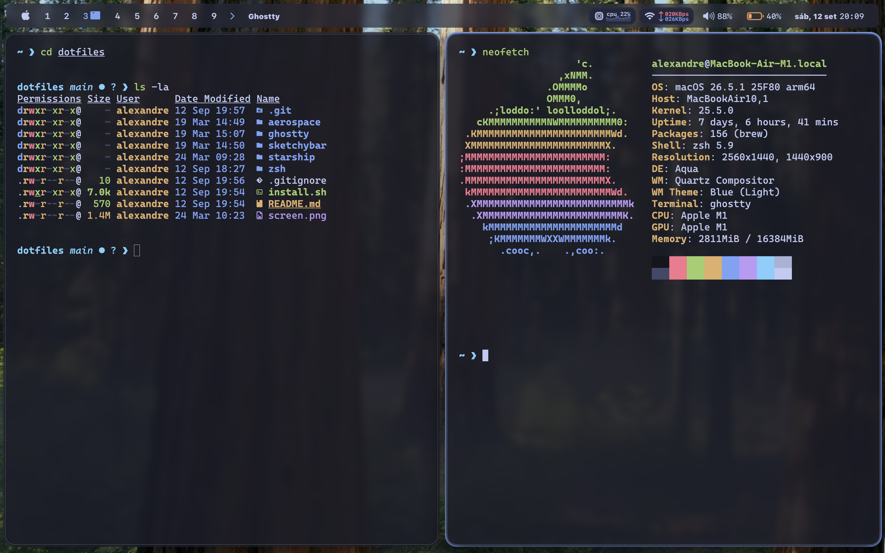
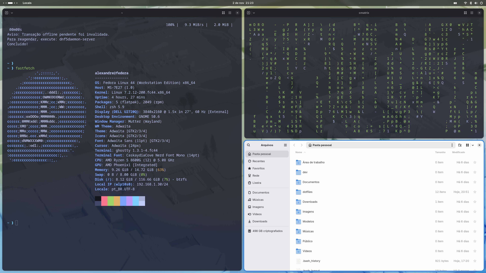

# My dotfiles

My personal dotfiles for **macOS** and **Fedora Linux (GNOME)**.

## Install

```shell
curl -o- https://raw.githubusercontent.com/lyralemos/dotfiles/main/install.sh | bash
```

The installation script automatically detects the operating system (**macOS** or **Fedora**) and installs the appropriate packages and configurations.

### Common Tools (macOS & Fedora)

* git
* zsh (set as default shell on Fedora)
* uv
* fzf
* zoxide
* Starship
* eza
* stow
* lua
* Node.js
* Bun
* Ghostty
* CaskaydiaCove Nerd Font Mono
* VS Code (`settings.json` + extensions: `iwyvi.chinolor`, `miguelsolorio.symbols`, `ms-vscode.makefile-tools`, `ms-python.python`, `batisteo.vscode-django`)

### macOS Specific

* Homebrew
* switchaudio-osx
* nowplaying-cli
* SketchyBar (with SbarLua)
* AeroSpace
* Janky Borders
* Fonts & Symbols (`sf-symbols`, `font-sf-mono`, `font-sf-pro`, `font-sketchybar-app-font`)

### Fedora (GNOME) Specific

* [snx-rs](https://github.com/ancwrd1/snx-rs) (Check Point VPN Client via official GitHub release RPM + `snx-rs.conf` stowed)
* Extension Manager (`com.mattjakeman.ExtensionManager` via Flatpak)
* GNOME Shell Extensions:
  * AppIndicator and KStatusNotifierItem Support (`appindicatorsupport@rgcjonas.gmail.com`)
  * Blur my Shell (`blur-my-shell@aunetx`)
  * Disable Workspace Switch Animation (`instantworkspaceswitcher@amalantony.net`)
  * O-tiling (`o-tiling@oliwebd.github.com`)
* Custom GNOME & O-tiling Configurations (`dconf`):
  * GNOME Overview mapped to `<Super>Space` (disabled on single `<Super>` press)
  * 5 fixed workspaces with `<Super>1..5` to switch and `<Shift><Super>1..5` to move windows
  * Application shortcuts: `<Super>Return` (Ghostty) and `<Shift><Super>Return` (Firefox)
  * O-tiling layout, gaps, transparency, animations, and Vim-style focus/resize bindings

---

Dotfiles are managed by [GNU Stow](https://www.gnu.org/software/stow/).

SketchyBar (on macOS) is a simplified version of [Felix Kratz's](https://github.com/FelixKratz/dotfiles) config with support for AeroSpace.

## Screenshots

### macOS



### Fedora (GNOME)


